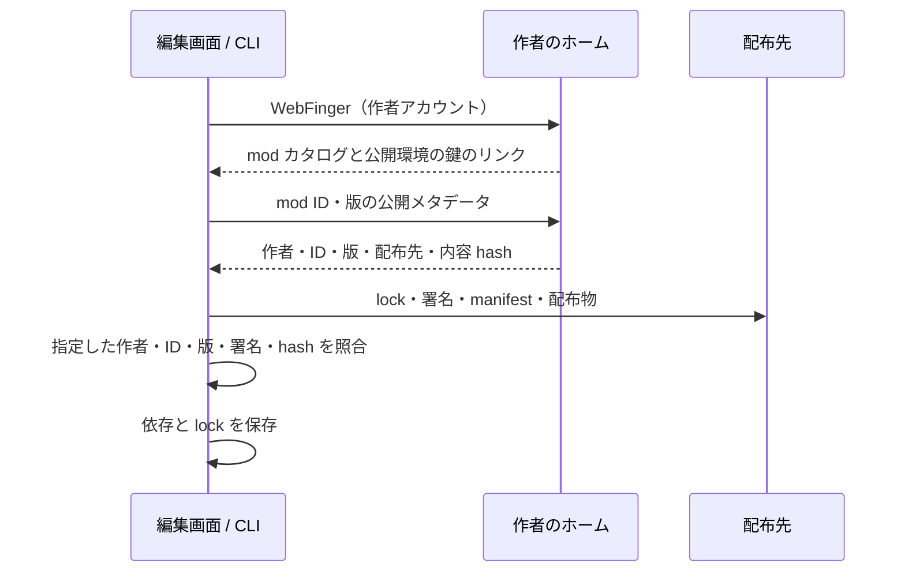

# 作者のアカウントから mod を見つけて使う

状態: 作者参照の install・作品ページ・ローカルカタログ・package 内プレハブ・差分更新・Unpack を実装。
配布物と版履歴は作者の配布先に置き、サーバーは既存の上限付き external_works に作者＋mod ID ごとのポインタだけを持つ。
以下の設計のうち、DBへの全リリース保存、ミラーの再解決、known 検索、リリース Note の配送は将来の拡張で、今回の実装には含めない。

プレハブは配置後も元の package・版・manifest hash・Entity ID 対応を保つ。
更新前の manifest と配置側の編集、更新先の manifest を比較して、編集を残しながら明示的に差分を適用する。
Unpack すると関連を外して通常の Entity 一式になる。本体の標準 Component は予約済みの core: 名前空間で提供する。

## 目指す体験

mod を探す人が配布ディレクトリの構造を知らなくても、作者と作品を確認して自分のワールドへ追加できるようにする。
ブラウザと CLI は同じ作品の参照・解決・作者確認の規則を使う。

```sh
ubichill install @youkan@ubichill.com/pen
ubichill install @youkan@ubichill.com/pen@1.2.3 --world world.yaml
```

最初のコマンドは、そのプロジェクトにあるワールドへ mod を追加し、版と内容を固定する。
公開 mod の検索・閲覧・取得にログインは要らない。自分の作品の公開や、サーバーに保存したワールドの編集では本人の権限を確かめる。

## 参照と URL

| 用途 | 例 | 意味 |
|---|---|---|
| 作品の完全な参照 | `@youkan@ubichill.com/pen` | 作者アカウント + 変更しない mod ID |
| 版を指定した参照 | `@youkan@ubichill.com/pen@1.2.3` | 完全な参照 + SemVer の完全一致 |
| 人に共有するページ | `https://ubichill.com/@youkan/mods/pen` | 説明・作者・版・利用する操作 |
| 特定の版のページ | `https://ubichill.com/@youkan/mods/pen/versions/1.2.3` | その版の内容・権限・作者確認 |
| 配布の基点 | `https://cdn.example/mods` | 既存の loader が `pen/v1.2.3/…` を取得する場所 |

`@youkan@ubichill.com/mod` の最後の `mod` は種類を示す語ではなく作品の ID と解釈する。
`install` では mod の参照だと分かるので種類のセグメントを省ける。
共有ページは既存のワールドの `https://ubichill.com/@youkan/test` と区別するため `/mods/` を入れる。
作品の参照、表示名、配布場所は別の項目として持つ。表示名の変更や同じ配布物の移設で作品の参照は変わらない。
内部では `{ author: 'youkan@ubichill.com', modId: 'pen' }` を同一性の基準とし、文字列の解釈を shared に一本化する。

作者アカウントのドメインの移転は別の移行手続きが必要。同じ名前・表示名・配布 URL という理由で別ドメインの作者へ引き継がない。
短縮したローカル名も、保存するときには完全な作者アカウントへ正規化する。

## ワールドを作るときの動線

1. プロフィールの mod、サーバーの検索結果、またはフェディバースのリンクから作品ページを開く。
2. 説明・作者アカウント・版・必要な権限・作者確認の状態を見る。
3. 「ワールドに追加」を押す。編集しているワールドが分かるときはそのワールドへ、分からなければ編集できるワールドを選ぶ。
4. 署名と配布物を確認し、依存と lock をまとめて保存する。失敗したら元のワールドを保つ。
5. インスペクターで使える Component を選べるようにする。追加だけで勝手に実行権限を許可しない。

部屋の HUD から開いたときは部屋との接続を保ち、作品ページと選択を重ねて表示する。
CLI 向けには「インストールコマンドをコピー」、従来の利用向けには「配布 URL をコピー」を用意する。
検索の結果を選ぶときと、完全な参照を直接入力するときで同じ解決処理を呼ぶ。

## CLI の挙動

- `ubichill install world.yaml` は、従来どおり既存の依存から lock を作る。
- `ubichill install @author@server/modId` は、依存の追加と lock の生成を行う。
- `--world` が無いときは既存のプロジェクト設定、または候補が一つのワールドを選ぶ。候補が複数なら選択を求め、非対話実行では対象の指定を案内して変更せず終了する。
- URL で作品ページを渡す形も同じ完全な参照に解決する。従来の配布 URL による依存は維持する。
- 追加時に選んだ正確な版を固定する。公開側の latest が変わっても、作ったワールドの中身を自動では差し替えない。
- `ubichill update world.yaml pen` で同じ作者の新しい版を探し、権限・Component・版の差分を表示して更新する。CI では増える権限を明示的に受け入れるオプションを必要にする。
- 検索は `ubichill search pen --server https://ubichill.com` の形を用意する。対象は指定したサーバーのカタログで、結果には完全な作者参照を出す。
- 取得・検証が一つでも失敗したら YAML と lock を変更しない。ワールドの署名は依存の変更によって無効になるので、既存の publish で署名し直す。

現在の Component は `pen:stroke` のように mod ID を名前空間にしている。同じワールドへ作者の異なる同名 mod を追加するときは、初期実装では衝突を明示して拒否する。
既存の `pen` を別の作者の `pen` で上書きしない。別名による共存は、Component の参照まで含めた次の設計で扱う。

## 解決と作者確認



WebFinger に `rel: https://ubichill.com/ns/mods` を追加する案とする。
作者のアカウントと同じオリジンのカタログを信頼し、別のサーバーに保存された検索結果も作者のホームへ戻って確かめる。
配布物は GitHub Pages・CDN・作者のサーバーなどへ置ける。カタログは公開メタデータの解決を担当する。
単純な HTTP リダイレクトで配布ディレクトリを代用せず、実際の `baseUrl` を loader に渡す。相対 Worker・asset の取得先をそろえる。

新しい lock では作品の参照・版・hash を固定し、配布先は取得の手掛かりとして扱う。
記録した配布先が使えなくなったら、同じ作者のカタログから**同じ版・同じ hash**のミラーを解決して再取得できるようにする。
自動で別の版や別の内容へ更新しない。作者の確認にも既存の有効期限を適用する。
旧 lock v1 は配布先 URL を直接持つため、この移設時の再解決は新しい lock に限る。旧版には旧 URL の維持やリダイレクトが必要になる。

検証では、署名が有効なことに加えて、指定した作者アカウント・mod ID・版と一致することを要求する。
現在の `ModLockEntry` は作者を固定していないため、依存と lock に期待する作者を保持し、実行時にも照合する変更が必要。
作者指定は署名した内容の一部にする。配布先を乗っ取られても、別作者の有効な署名を持つ同名 mod への入れ替えを通さない。
既存の公開環境の失効・確認結果の有効期限・capability の許可の仕組みを共用する。

新しい作者固定の規則は、古い loader に無視させない。lock の版と対応機能を更新し、未対応のクライアントには互換性のエラーを返す。
従来の URL 依存・lock v1 を読む経路は維持する。このプロトコルの変更と loader・Host の対応は、作者参照の install を公開する前にそろえる。

「作者確認済み」は、そのアカウントの有効な公開環境の鍵で内容が署名されていることを示す。作品ページには必要な権限も並べる。
作者確認の信頼モデルは [author-publishing.md](./author-publishing.md) と同じで、作者のホームサーバーの運営者はその作者を名乗れる。
署名鍵・カタログへ到達できない状態と、鍵の失効・内容の不一致は区別する。既存の検証結果の期限を越えて新しいインストールを成功扱いにしない。

## カタログと版

作者のホームに、作者 + mod ID の作品と、そのリリースを保存する。

| 単位 | 主な項目 |
|---|---|
| 作品 | 作者、mod ID、表示名、説明、ページ URL、公開状態、最新版 |
| リリース | 作品、版、内容 hash、manifest hash、公開日時、配布先、署名の参照、確認状態・確認時刻 |

同じ作品・版に異なる hash を再登録したら409で拒否する。同じ内容の配布先の追加・移設や、鍵の更新による同じ内容への再署名は扱えるようにする。
最新版は検証できた安定版の SemVer から選び、プレリリースは明示して選ぶ。

現在の `external_works` は URL + 名前が主キーで、mod の版は最後の登録値一つである。
全リリースのカタログとしては不足するため、作品・版の保存を追加し、既存の登録を最新の確認済みリリースとして取り込む。
過去の版を勝手に推測して一覧へ載せず、作者が再公開・登録して確認できたものを追加する。
失効・配布停止の作品も、既存の依存を編集する人が理由を確認できるよう状態を表示する。新規追加の可否は現在の検証結果で判断する。

API の案:

| API | 内容 |
|---|---|
| `GET /api/v1/authors/:handle/mods` | その作者が公開している mod（ページング） |
| `GET /api/v1/authors/:handle/mods/:modId` | 作品と最新版 |
| `GET /api/v1/authors/:handle/mods/:modId/versions/:version` | 版の正確な内容・配布先 |
| `GET /api/v1/mods?q=…&scope=local` | このサーバーの公開 mod |
| `GET /api/v1/mods?q=…&scope=known` | このサーバーが知っている公開 mod（由来を表示） |

公開メタデータの取得は認証不要。登録・更新は本人の公開環境の認証と署名で検証する。
ネットワークの取得は既存の safeFetch を使い、取得量・同時接続・時間・ページ件数に上限を設ける。

## サーバーごとの検索とフェディバース

サーバーはローカルの公開 mod と、利用・参照によって知った外部 mod の索引を持つ。
一般の名前検索では全サーバーに問い合わせをばらまかず、ローカル・既知の結果を返す。
完全な作者参照や作品 URL の検索では作者のホームへ直接解決する。未知のサーバーでも、検索結果へ先に登録されている必要はない。
他サーバーの作品には作者の完全なアカウントと取得元・確認状態を出し、ローカルの同名作者と取り違えないようにする。
各サーバーのドメイン方針を外部検索・解決に適用し、ログイン中の画面では本人のブロック設定を検索・追加にも適用する。
公開情報を匿名で取得する CLI は、その人のサーバー側のブロック設定を知ることはできない。認証や手元の設定から取得できる制限を適用し、実行する Host では現在の利用者のブロック設定を照合する。

フェディバースには、まず既存のプロフィールの固定ノートに個別の mod ページへのリンクを載せる。
現状は mod 全部が作者のプロフィールへリンクしているので、作品へのリンクへ置き換える。
作品ページには OGP・canonical・構造化データを付け、検索・SNS 共有の入口にする。

次の段階でリリースを通常の公開 Note として告知する。作品ページへのリンク、作者、版、説明を含め、公開した内容を後から別物へ変えない。
更新・削除は既存の連合配送と片付けの規則に合わせる。
Misskey・Mastodon の全文検索範囲や URL の解決は相手の実装・設定にも依存するため、アカウント・作品 URL・リリース Note のそれぞれを実機で検証する。
独自の mod 型だけを送って、通常の検索で見つかる前提にはしない。

## 実装する順番

1. **識別・保存・作者確認**: shared の参照 parser と descriptor、作者・版を持つカタログ、既存作品の取り込み、公開 API。lock の作者固定と互換性の設計もここで確定する。
2. **作品ページと追加の共通処理**: ページ・OGP・プロフィールからのリンク、loader の参照解決・検証、対応する Host、CLI の install。URL 依存の既存テストを保つ。
3. **ワールド編集と検索**: mod 検索、作品ページから編集中のワールドへの追加、Component 選択、更新の差分。すべて手順2の解決処理を呼ぶ。
4. **フェディバースの発見**: 固定ノートのリンク、リリース Note、Misskey・Mastodon での解決と表示の確認。

主な置き場所の案は `shared/src/mod/`（参照・descriptor・規則）、`loader/src/`（解決・検証）、
`backend/src/services/mods/`（カタログ）、`frontend/src/components/mods/` と作品ページ、`cli/src/`（引数とファイル更新）。
検索と実行で作者確認を二重実装しない。

## 受け入れ条件

- 配布先を知らずに完全な参照からインストールでき、ブラウザの追加と同じ版・内容・作者へ解決される。
- 同じ ID を名乗る別作者、同じ版の内容差し替え、失効した鍵を通さない。Host・ログイン中の画面では本人がブロックした作者も通さない。
- 検索結果のキャッシュだけを根拠にインストールしない。到達不能と失効の表示を分ける。
- 公開側が更新しても、既存ワールドの固定した版・hash・期待する作者は変わらない。
- 配布先の移設で作品ページの URL は変わらず、同じ内容の検証が続けられる。
- 同名 mod の衝突・取得失敗・検証失敗で既存の依存と lock を壊さない。
- 未対応の loader が作者固定の新形式を既存の同名ローカル mod として読み替えない。
- 旧 URL 依存のワールドも引き続き読み込める。
- ワールド内の HUD から追加を始めても、別の部屋へ移動したり接続を切ったりしない。
