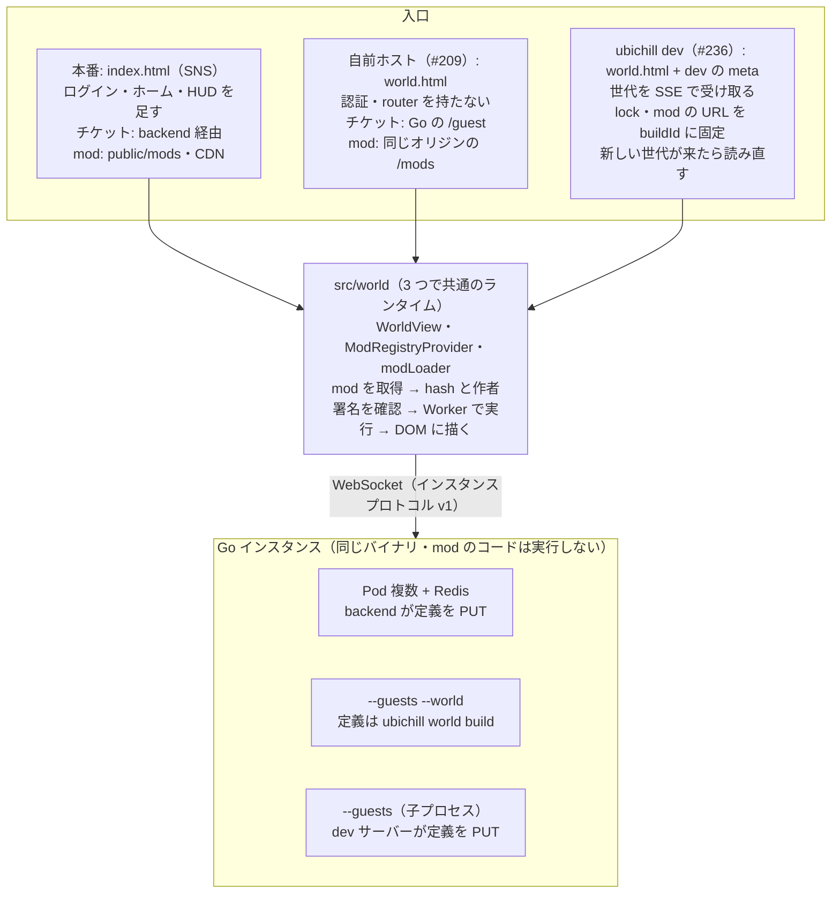

# ワールドランタイムの分離と `ubichill dev`（Go 一本化・CLI 分離）

関連: [#236](https://github.com/ubichill/ubichill/issues/236)・[#209](https://github.com/ubichill/ubichill/issues/209)。2026-10-16 版の設計（Go の room コアを WASM にしてブラウザで動かす案）を置き換える。

この段階では、今の実装の流用や後方互換を優先せず、理想の形で決める。今のコードに合わせた妥協（`buildMod` を無改造で使う、など）はしない。

## 要約

mod を動かす部分（Host のランタイム）を SNS から分けて 1 つの画面 `world.html` にし、同期は本番と同じネイティブの Go に一本化する。mod 開発者は `npm i -D @ubichill/cli` と `ubichill dev` だけで、Docker・DB・Go のツールチェーン無しに、本番と同じ判定で mod を確かめられる。

- **権威は Go だけ**: ブラウザ内の権威（TS の簡易版・Go の WASM）は作らない。Go のバイナリは npm のプラットフォーム別パッケージで配る。
- **ランタイムは 1 つ**: 本番の SNS・自前ホスト（#209）・`ubichill dev`（#236）が同じ `src/world/` を使う。単体モード（`STANDALONE_RUNTIME`）は廃止する。
- **npm を 3 種に分ける**: `ubichill`（SDK、依存 0、bin 無し）・`@ubichill/cli`（build と dev）・`@ubichill/instance-<os>-<arch>`（Go のバイナリ）。
- **dev は不変の世代で配る**: ビルドの結果を `buildId` 付きの URL に固定した「世代」にし、lock・manifest・Worker・asset・部屋を 1 つの世代として揃えて切り替える。
- **作業の重心は分離**: 分離が終われば、手で Go を起動するだけで dev はできる。`ubichill dev` はその手順を 1 コマンドにする層である。

インスタンスプロトコル v1・SDK の公開 API・`PROTOCOL_VERSION` は変えない。

## 背景と 10/16 版から変えること

10/16 版の後、Go に Directory・owner の fencing・handoff（引っ越し）・KEDA・カーソルのまとめ送りが入り（#248–#288）、media は汎用の共有状態になった（#262）。`internal/runtime` の判定は今も `*peer`・`time`・リースと絡み、room コアの抽出は本番の境界と引っ越しの両方に触る。

一方で Go は単体で軽い。直接の依存は gorilla/websocket と go-redis だけで、`INSTANCE_DIRECTORY` 未指定ならメモリ、`--guests` で Redis・DB・Node 無しに起動できる。

| 項目 | 10/16 版 | 本版 | 理由 |
| --- | --- | --- | --- |
| dev の権威 | Go の WASM（既定）＋ `--multi` でネイティブ | ネイティブの Go だけ | WASM は room 抽出・`wasm_exec.js` の版管理・CSP の `wasm-unsafe-eval`・2–3MB・2 つの動かし方を抱える |
| クライアントの線 | `FrameLink` と `InstanceSession` に分割 | `InstanceSocket` のまま | 線は WebSocket 1 種類しかなくなる |
| room コアの抽出 | Phase 2（最大のリスク） | この設計から外す | dev に不要。テストのための整理として別に扱う |
| ランタイム専用画面 | `dev-shell.html` | `world.html`（dev と自前ホストで共用） | #209 と #236 を同じ画面で解く |
| リロード | mod 単位の差し替え | ページ全体の読み直し | entity は Go にあるので残る。順序の罠がなくなる |
| 配る単位 | メモリの Map を丸ごと差し替え、`/mods/` は常に最新 | `buildId` 付き URL に固定した不変の世代 | 取得の途中で切り替わると lock と manifest・Worker が食い違う |
| ビルド | `compileMod` + `writeArtifacts` に分割 | 同じ（`compileMod` は入力の一覧も返す） | 監視する対象をビルド自身が知っている |
| ワールドの変更 | 管理 API で DELETE → PUT | 新しい ID の部屋を先に作ってから切り替える | PUT が拒否されても前の部屋が残る |
| CLI の配布 | `ubichill` に同梱 | `@ubichill/cli` に分け、`ubichill` は SDK だけ | SDK を依存 0 のまま軽く保つ |
| エディタの再生 | WASM でブラウザ内 | 別 issue（下書きから使い捨ての非公開インスタンスを作る） | エディタは SNS の中にあり、サーバーにつながっている |

10/16 版から残すもの: `flattenGameObject` の shared への移動と `toInstanceDefinition`、`WorldView` を frontend 内に置くこと、dev で緩めるのは lock の生成元だけという規則。

## 役割分担: Go とブラウザ

Go は共有する状態を預かる同期係で、mod のコードは実行しない。mod は参加者全員のブラウザがそれぞれ動かし、結果を Go 経由で共有する。

| 持つもの | Go（`services/instance`） | ブラウザ（`world.html` / SNS のインスタンス画面） |
| --- | --- | --- |
| 通信 | WebSocket、入退室、配信、15 秒の猶予、カーソルのまとめ送り | `InstanceSocket`（チケット、再接続、ack） |
| 状態 | 参加者、entity、汎用の共有状態（正本） | そのミラーと、Worker 内の `ubi.state`（そのブラウザだけ） |
| 検査 | ロックと所有者、サイズ・個数の上限、形の検査、レート制限、チケットとゲスト | lock の hash と作者署名、`capabilityGate`、権限ダイアログ、`commandSecurity` |
| mod | 中身を不透明な JSON として扱う | 取得し、サンドボックスの Worker で実行し、VNode を DOM に描く |
| スケール | Directory、fencing、handoff（本番の複数 Pod のときだけ） | なし |

この分担から決まること:

- mod 固有のルールはサーバーで強制できない。Go が止められるのは汎用の検査だけで、この設計でも変えない。
- dev でも Go は要る。mod は入室の snapshot、`entity:create` の応答、ロックに依存しており、応える相手がいないと入室で止まる。
- ページを読み直しても entity と共有状態は残り、`ubi.state` は消える。mod 単位の差し替えでも `ubi.state` は消えるので、リロードの粒度で失うものは少ない。

## 全体像



本番・自前ホスト・dev で違うのは、入口の HTML、mod と lock の取得元、Go の起動の仕方の 3 点だけである。mod を動かす `src/world/` と、同期を担う Go のバイナリは 3 形態で同じものを使う。

## mod を動かす部分の分離

frontend に `src/world/` を作り、エントリを `index.html`（SNS）と `world.html`（ランタイムだけ）の 2 つにする。新しいパッケージは作らず、PandaCSS と className の境界もそのまま守れる。

### 置き場所

| 場所 | 置くもの | 元 |
| --- | --- | --- |
| `frontend/src/world/` | `WorldView`（`InstanceRenderer` + `EntityRenderer`）、`ModRegistryProvider`、`modLoader`、入室の流れ（取得 → 未署名の確認 → join） | `src/instance/`、`src/mods/`、`InstancePage` |
| `frontend/src/worldApp/` + `world.html` | ランタイム専用のエントリ。認証・router・backend API を持たない | 新設 |
| `frontend/src/pages/InstancePage.tsx` | SNS 版。`WorldView` に `InstanceHUD` とログイン・ホームへの導線を足すだけ | 縮小 |
| `@ubichill/shared` | `flattenGameObject`、`toInstanceDefinition(world, { id, maxUsers })` | backend から移動・追加 |

### 外から渡すもの

`WorldView` は接続先と mod の置き場所を props で受け取る。グローバルな `MOD_BASE_URL` と `STANDALONE_RUNTIME` は消す。

- `resolveInstance`: チケットの取得。SNS は backend 経由、`world.html` は Go の `/guest` を直接叩く。
- `modBaseUrl`: SNS は今の `MOD_BASE_URL`、`world.html` は同じオリジンの `/mods/`。lock の各エントリに `baseUrl` があればそちらが優先される（loader の既存の規則）。
- `lock`: 本番と自前ホストは Go の snapshot の lock、dev は世代の lock。

`world.html` は「Go と `/mods` は同じオリジン」を前提にし、設定ファイルを持たない。インスタンス ID は URL のパスから取り、省略時は `default`。

### ビルドを分ける

`world.html` は SNS の画面とは別のビルドで作る（`pnpm --filter @ubichill/frontend build:world` → `packages/frontend/dist-world/`、設定は `vite.world.config.ts`）。

- 入口が `world.html` だけなので、chunk は world から辿れるコードだけでできる。SNS の chunk を共有しない。
- CSS も、world から辿ってよいファイル（`WORLD_APP_ALLOWED`）だけから抽出する（`panda.world.config.ts`）。テーマとトークンは SNS と同じ。
- `public/`（同梱の mod・アバターの画像）は写さない。
- `@ubichill/cli` はこの出力をそのまま同梱する。SNS の画面のビルド（`build` → `dist/`）には依存しない。

### dev だけの差

- dev サーバーが `world.html` に `<meta name="ubichill-dev">` を差し込むと、`world.html` は世代を SSE から受け取り（後述）、その世代の lock・インスタンス ID を使う。未署名の mod は、その世代の URL から来たものだけを「未署名・ローカル」として動かす（`allowUnsigned(baseUrl)` で判定）。
- URL のクエリでは dev を有効にしない。他人のリンクで未署名の mod を動かせる状態にされないため。HTML を書き換えられるのは配信元だけで、配信元はもともと Host のコードを支配している。
- hash の照合、`capabilityGate`、権限ダイアログ、`commandSecurity` は本番と同じコードを通る。

### 境界を機械で守る

`world.html` から辿れるコードは、mod の実行に要るものだけに限る。直接の import を禁じるだけでは、別の helper を経由した依存（今の `lib/instancesApi` → `lib/api` のような）が残るので、依存の閉包を検査する。

1. **許可リストで閉包を検査する**（`scripts/architecture.mjs` の新しい規則 `world-app-closure`）: `src/worldApp/main.tsx` から esbuild の metafile で辿れる全モジュールを、許可リストと照合する。
    - 許可: `frontend/src/world/**`、`frontend/src/worldApp/**`、`styled-system/**`、UI の共通部品、`@ubichill/{react,sandbox,ui-renderer,shared,loader,ecs,core-components,runtime}`、`react`、`react-dom`
    - それ以外の `frontend/src/**`（`pages/`、`lib/api`、`lib/session`、`lib/signing` など）や `better-auth` が 1 つでも入ったら失敗する。失敗時は、許可外のモジュールに至る import の連鎖を表示する。
2. **既存の `host-runs-mods-without-backend` を移動先にも適用する**: `applies` に `frontend/src/world/` と `frontend/src/worldApp/` を足す。ファイル単位で `lib/api` の import と `/api/v1` の文字列を拒む規則は、そのまま残す。
3. **実際の通信を E2E で確かめる**: `world.html` を開いて mod を動かす間に出たリクエストを集め、同じオリジンの `/realtime/v1/*`・`/__ubichill/*`・`/mods/*`（と mod が権限で許された外部）以外が 0 件であることを確かめる。

これで #209 の「未確認のワールドを拒否すると `/` と `/instance/standalone` を行き来する」は、`world.html` に router がないので構造的に起きなくなる。`fetchInstance` は生成済みの `RuntimePresence` を使う。

## 配布: npm の構成

npm を SDK・CLI・Go のバイナリの 3 種に分ける。今の `ubichill@3.3.0` は `cli.js` が 1.19MB で `esbuild`・`yaml` に依存し、mod が使う部分（`index.js` 76KB、`jsx-runtime.js` 2KB、`gripable.js` 3KB）よりずっと重い。

| パッケージ | 中身 | 依存 | ワークスペース |
| --- | --- | --- | --- |
| `ubichill`（4.0.0） | 型と、mod に同梱される小さな実行時コード。bin なし | 0 | `packages/sdk`（中の名前は `@ubichill/sdk` のまま） |
| `@ubichill/cli`（bin `ubichill`） | build・install・update・verify・publish・login・`world build`・`dev`、`world.html` の成果物 | `esbuild`、`yaml`、optional に instance の各パッケージ | `packages/cli`（中の名前も公開名も `@ubichill/cli`） |
| `@ubichill/instance-{darwin-arm64,darwin-x64,linux-x64,linux-arm64,win32-x64}` | Go のバイナリだけ。`os`・`cpu` を指定し、入るのは 1 つ | 0 | CI が生成 |

この分け方にした理由:

- **`ubichill` は型だけにはしない。** mod は `findOverlapping`・`isOverlapping`・`CORE_COMPONENT_TYPES`・`Gripable`・JSX を実行時に使い、mod に同梱している。型だけにするには Host が Worker にグローバルとして渡す必要があり、`PROTOCOL_VERSION` が上がる。数十KB のためには割に合わない。
- **build と dev を分けない。** dev は `compileMod` を監視つきで回して配るだけで、分けると共有のために 3 つ目のパッケージが要る。mod 開発者が入れる devDependency も 1 つで済む。
- **CLI は中の名前と公開名を揃える。** `@ubichill/sdk` と `ubichill` の食い違いで外部リポジトリが解決できなかった罠を、CLI では作らない。
- **Go は esbuild と同じ配り方。** 初回実行時に GitHub Releases から取りに行く形は npm のパッケージが増えないが、lockfile・プロキシ・社内ミラーの外に出て、検証も自前になる。

mod 開発者の `package.json`:

```json
{
  "dependencies": { "ubichill": "^4" },
  "devDependencies": { "@ubichill/cli": "^1", "typescript": "^5" },
  "scripts": {
    "dev": "ubichill dev",
    "build": "tsc --noEmit && ubichill build"
  }
}
```

### リリース

- `@ubichill/cli` と instance の各パッケージは changesets の fixed グループで同じ版にする。cli の optionalDependencies は完全一致の版を指す。
- Go は `CGO_ENABLED=0` でクロスビルドし、版は mise.toml の Go に従う。
- 公開は今と同じ Trusted Publishing（OIDC）。新しいパッケージは、初回だけ手動で 0.0.0 を出し、それぞれに Trusted Publisher を設定する（npm の org 管理者の操作）。

### 移行

- `ubichill` 4.0.0 で bin と `esbuild`・`yaml` を消す。非推奨の期間は置かず major で切る。
- ubichill-videoplayer と chillwa の devDependencies に `@ubichill/cli` を足す。README と、今後の `ubichill init` の雛形もこの形にする。

## ビルドの分割: `compileMod` と `writeArtifacts`

今の `buildMod` は、package.json の読込・Worker の探索・`esbuild.build()`・asset のコピー・dist と public への書き出しを 1 関数で順に行う。これを 2 つに分ける。

```ts
interface ModArtifacts {
    id: string;
    version: string;
    /** `<id>/v<version>/...` からの相対パス → 中身。manifest・lock.json・Worker・asset のすべて */
    files: ReadonlyMap<string, Uint8Array>;
    lockEntry: ModLockEntry;
    /** このビルドが読んだファイルの絶対パス（esbuild の metafile の inputs ∪ package.json ∪ tsconfig ∪ assets/ 以下） */
    inputs: ReadonlySet<string>;
}

/** 書き込みをしない。毎回 package.json を読み直し、Worker と asset を探し直す */
export function compileMod(modDir: string, options: CompileOptions): Promise<ModArtifacts>;
/** dist / public に書き出す。ubichill build は compileMod → writeArtifacts を呼ぶだけ */
export function writeArtifacts(dir: string, artifacts: ModArtifacts): void;
```

`compileMod` は毎回すべてを探し直す。Worker の追加・削除、asset の追加、package.json の版の変更を差分で追う仕組みは作らない。esbuild の 1 回のビルドは十分に速いので、mod 単位の全体ビルドで足りる。

## `ubichill dev`

`ubichill dev [world.yaml]` は、Go の起動・mod の監視ビルド・自動リロードを 1 コマンドにまとめる。サーバーは `node:http` と esbuild だけで動き、Vite・Docker・DB は使わない。複数タブ・複数ブラウザの同期は最初から動く。

### 世代

dev サーバーが配るものは、すべて不変の**世代**に属する。ブラウザは 1 つの世代を最初から最後まで使い、取得の途中で別の世代と混ざらない。

```ts
interface Generation {
    /** `<起動ごとの乱数>-<連番>`。dev サーバーを再起動しても前の値と衝突しない */
    buildId: string;
    /** 全 mod の成果物。前の世代と変わらない mod は同じ参照を共有する */
    mods: ReadonlyMap<string, ModArtifacts>;
    /** 各エントリの baseUrl は `/__ubichill/g/<buildId>/mods` */
    lock: ModLock;
    /** この世代のブラウザが入る部屋 */
    instanceId: string;
}
```

- 世代は作ったら変えない。`current` の参照を差し替えることだけが「切り替え」である（Node のシングルスレッドで 1 回の代入）。
- lock の `baseUrl` を世代の URL にするので、loader は manifest・Worker・asset をすべてその世代から取る（loader は lock の `baseUrl` を既定より優先する）。manifest の URL は `<baseUrl>/<mod>/v<version>/manifest.json` で、版が同じでも世代ごとに別の URL になる。
- 手元でビルドした mod は、world.yaml の `source.url` に置き場所が書いてあっても手元を使う（dev は作業中のコードを動かすためのもの）。手元に無い mod は、world.yaml の横の `.lock.json` にあればその版（本番と同じ）、無ければ `source.url` から取る。外から取るのはワールドを作り直すときだけで、mod の保存では前の世代の版を使う（保存のたびに外へ取りに行かない）。
- 世代は直近 3 つまでメモリに残す。それより古い世代の URL は 404 を返す。そのページは既に新しい世代の通知を受けているので、読み直しで追いつく（後述）。

### ルート（すべて同じオリジン）

| ルート | 内容 |
| --- | --- |
| `/`、`/<任意のパス>` | `world.html`（`<meta name="ubichill-dev">` を差し込む） |
| `GET /__ubichill/events` | SSE。送るのはどちらも「今の状態」で、接続した直後と変わるたびに送る: `generation {buildId, instanceId}`（今の世代）と `diagnostics {failures}`（今の失敗の一覧。`{kind: 'build', mod, message}` か `{kind: 'world', message}`。成功すれば空）。出来事として送らないので、先に起きた失敗も遅れて開いたタブに見え、壊して元に戻した（公開しない）ときも診断が消える |
| `GET /__ubichill/g/<buildId>/lock.json` | その世代の lock |
| `GET /__ubichill/g/<buildId>/mods/<id>/v<version>/...` | その世代の成果物。中身は変わらない |
| `/realtime/v1/*` | 子プロセスの Go へプロキシ（WebSocket を含む）。それ以外のパスは Go へ渡さない |

最新を指す可変の `/mods/` や `/__ubichill/lock` は置かない。

### ページの起動と追従

1. `EventSource('/__ubichill/events')` を開き、最初の `generation` を待つ。世代の正本は SSE だけにし、別の取得と競合させない。
2. その `buildId` の lock を取得し、`instanceId` の部屋に入る。以後の mod の取得はすべてこの世代の URL になる。
3. 保持している `buildId` と異なる `generation` を受けたら、ページ全体を読み直す。
4. SSE が切れても `EventSource` は自動で繋ぎ直し、サーバーは接続の直後に今の世代を送る。切断中に何回切り替わっても、繋ぎ直した時点の比較で追いつく。
5. 世代の URL が 404 を返したら（世代が既に消えている）、読み直す。

### 監視と再ビルド

ファイルの監視は `fs.watch`（recursive）でプロジェクトのルートに 1 つ張り、`node_modules`・`.git`・`dist`・`.ubichill` を除く。変更は 100ms まとめてから、パスで次のように分ける。

| 変わったもの | すること |
| --- | --- |
| mod のディレクトリ内のファイル（ソース、`package.json`、Worker の追加・削除、`assets/`、`tsconfig.json`） | その mod を `compileMod` で全体ビルド |
| mod の外のファイルで、ある mod の前回の `inputs` に含まれるもの（共有のローカルコード） | それを読んだ mod をすべてビルド |
| mod のディレクトリ自体の追加・削除 | mod の一覧を探し直し、増えた mod をビルドする。ワールドの再構成も行う |
| `world.yaml` | ワールドの再構成 |
| mod の `id`・`version` の変化（ビルドの結果として判明） | ワールドの再構成（定義の `availableComponents`・`activeMods` が変わるため） |
| それ以外 | 何もしない |

ビルドは常に 1 つずつ実行する。ビルド中に来た変更はためておき、終わったら 1 回にまとめて次のビルドにする。こうすれば、世代は必ず作った順に公開される。

pipeline が持つ状態は 3 つに分ける（`packages/cli/src/dev/pipeline.ts`）。

| 状態 | 中身 | 変わるとき |
| --- | --- | --- |
| published（公開した世代） | ブラウザが使っている世代と、その部屋の定義 | 公開に成功したときだけ |
| unpublished（まだ公開できていない変更） | 変わったと知らされた mod・mod の一覧の探し直し・部屋の作り直し | 知らせが来たら足す。公開に成功したら、そのビルドが反映した分だけ消す |
| discovered（監視の情報） | mod のディレクトリ、各 mod が読んだファイル | 探したとき・ビルドしたとき（公開の成否と関係なく） |

失敗した後の変更は unpublished に合流するので、A を直して B が壊れ、B を直したときも A の変更は次の世代に入る。初回のビルドが失敗しても mod は監視の対象に入っているので、直して保存すれば公開される。失敗の後は、次の知らせが来るまで同じビルドを繰り返さない。

### 世代を確定する順序

切り替えは「全部が成功したら最後に 1 回だけ公開する」。途中で失敗したら、`current` も Go の部屋も触らない。

1. 対象の mod を `compileMod` でビルドする（1 つでも失敗したら中止）。
2. 前の世代の成果物と組み合わせ、新しい lock を作る（`buildWorldLock` と同じ規則）。
3. ワールドの再構成が要るときだけ:
    1. `world.yaml` を解決・検証し、新しい lock を使って `toInstanceDefinition` で定義を作る（無ければ、各 mod を 1 つずつ中央に置いたワールドを生成する）。
    2. 新しい ID（`dev-<buildId>`）で Go に PUT する。Go がサイズや transform で拒否したら中止する。前の部屋はそのまま残る。
4. `current` を新しい世代に差し替え、SSE で `generation` を送る。
5. 部屋を作り直したときは、前の部屋を 30 秒後に DELETE する（読み直し中のページを切らないため）。

| 失敗した段階 | 結果 |
| --- | --- |
| 1・2（ビルド・lock） | 前の世代のまま。診断に `build` を入れて送る |
| 3（解決・検証・Go の拒否） | 前の世代と前の部屋のまま。診断に `world` を入れて送る |
| 4 以降 | 失敗しうる処理を置かない |

「失敗したら前の版が動き続ける」の保証は、この表の範囲である。保証しないもの:

- 公開した後に mod が実行時に投げる例外（診断パネルに出す）
- Go のプロセスが落ちた場合。dev サーバーは Go を起動し直し、今の世代の定義を PUT し直す。部屋の状態は初期に戻る
- `world.yaml` を変えて部屋を作り直したとき、entity と共有状態は新しい定義の初期状態に戻る（意図した動作）

mod のコードだけが変わったときは部屋を変えないので、entity と共有状態は残る。Go の定義の中の lock は部屋を作った時点のものになるが、dev のページは世代の lock を使うので影響しない。

### Go の起動

- `@ubichill/instance-<os>-<arch>` のバイナリを `--guests --listen=127.0.0.1:<空きポート>` で起動する。管理トークンは起動ごとに乱数で作って環境変数で渡す。
- dev サーバーが終わるときは、自分が起動した Go の PID だけを止める。対応するバイナリが無ければ、`--omit=optional` の可能性と対応プラットフォームを示して終わる。

### `world.html` の dev の UI

`WorldView`、右上の小さな状態表示（今の `buildId`・接続・部屋を作り直すボタン。上端に帯を敷くと `overlay: top-left` の HUD が本番と違って隠れる）、診断パネル（`diagnostics` と `setDiagnosticHandler` の出力）の 3 つだけ。アイコンは SVG。エディタは含めず、配置は `world.yaml` を直接書き換える。部屋を作り直すボタンも、上の順序（新しい部屋を作ってから切り替える）を通る。未署名のワールドの入室確認は出さず、権限の許可はセッション中だけ記憶する。

### 自前ホスト（#209）との関係

自前ホストは同じ 3 つを並べるだけである: `ubichill world build world.yaml > definition.json` で作った定義で Go を `--guests --world=definition.json` で起動し、`world.html` と `ubichill build` の出力を同じオリジンで配る。dev との差は meta タグ、監視、世代だけ。

## 移行手順

PR は 6 つ。PR 1 と PR 2 が終われば、手で Go を起動するだけで mod を確かめられる。どの PR も単独でマージでき、どこで止めても main は動く。

| PR | 内容 | 前提 | 完了条件 |
| --- | --- | --- | --- |
| 0 | CLI を `packages/cli`（`@ubichill/cli`）に分け、`ubichill` を 4.0.0 にする | なし | `ubichill` の成果物に bin も依存も無い。`@ubichill/cli` の `ubichill build` の出力が移行前と一致する。ubichill-videoplayer が新しい形でビルドできる |
| 1 | `flattenGameObject` を shared に移し `toInstanceDefinition` を足す。backend の provision はこれを呼ぶだけにする。`ubichill world build` | 0 | provision が PUT する JSON が移行前と一致（スナップショット）。`world build` の出力で Go が `--world` 起動できる |
| 2 | `src/world/` と `world.html`。`STANDALONE_RUNTIME` と `VITE_INSTANCE_SERVER_URL` を消す。境界の 3 つの検査 | 1 | `world-app-closure` が通り、わざと `lib/api` を経由させたフィクスチャで失敗する。手で起動した Go と `world.html` で `mods/pen` が動く。SNS の 2 タブ同期が変わらない |
| 3 | Go をプラットフォームごとにクロスビルドし、`@ubichill/instance-*` として公開する | 0 | macOS・Linux・Windows の CI ランナーで、`npm pack` した cli を入れると Go が起動し `/health` が 200 を返す |
| 4 | `buildMod` を `compileMod` + `writeArtifacts` に分ける | 0 | `ubichill build` の出力が分割前とバイト単位で一致する。`inputs` に Worker・共有のローカルコード・asset が入る |
| 5 | `ubichill dev`（世代・監視・SSE・Go の起動）。`world.html` の成果物を cli に同梱する | 1, 2, 3, 4 | Docker も Go も無い環境で動く。`mods/pen` を保存して 2 秒以内に反映。ビルド失敗中・`world.yaml` の誤り中も前の版が動く。2 つのブラウザで同期。終了後に Go が残らない |

PR 0 と PR 1 は並行できる（PR 1 の `world build` だけ後から足してもよい）。PR 2・3・4 は互いに並行できる。

## テスト方針

判定は既存の Go のテストに任せ、この設計では変換・境界・dev サーバーの純粋な部分をテストする。UI コンポーネントのテストは書かない。dev サーバーは「世代の状態遷移」「HTTP の配信」「Go の管理 API」「ファイル監視」を分け、状態遷移は純粋関数として、HTTP は実際のサーバーを空きポートで立ててテストする。

- **`toInstanceDefinition`（PR 1）**: backend の元の出力とのスナップショット。入れ子の GameObject、core Component だけの entity、lock に無い mod を参照するワールド（弾く）、`maxUsers` が上限を超える場合。
- **境界（PR 2）**: `world-app-closure` が、直接の import・helper を 2 段経由した `lib/api`・`better-auth` のどれでも失敗し、許可外への連鎖を表示する。meta タグが無いとき、クエリやハッシュに dev を書いても未署名の mod が動かない。
- **`compileMod`（PR 4）**: `writeArtifacts` の出力が今の `buildMod` と一致する。Worker の追加・削除、asset の追加、`package.json` の版の変更が、次の `compileMod` の結果にそのまま出る。`inputs` に mod の外の共有コードが入る。
- **世代の一貫性（PR 5、複数リクエスト）**: 世代 1 の lock を取得 → 世代 2 に切り替え → 世代 1 の URL で manifest・Worker・asset を取得し、すべて世代 1 の中身で hash が合う。世代 1 の manifest を取得 → 切り替え → 世代 1 の Worker が 404 にならない。世代が 4 つ進んだ後の世代 1 の URL は 404。
- **SSE（PR 5）**: 接続の直後に今の世代が届く。切断中に 2 回切り替えてから繋ぎ直すと、最新の世代だけが届く。dev サーバーを再起動した後の `buildId` が前と衝突しない。
- **確定の順序（PR 5、偽の Go の管理 API）**: ビルド失敗・`world.yaml` の検証失敗・PUT の拒否のそれぞれで `current` が変わらず、前の部屋に DELETE が飛ばない。PUT の成功より前に `generation` が送られない。DELETE は公開の後にだけ飛ぶ。
- **監視（PR 5）**: 表の各行の変更で、正しい mod だけが再ビルドされる。ビルド中に 3 回保存すると、次のビルドは 1 回にまとまり、世代が後戻りしない。
- **配信（PR 5）**: `/__ubichill/g/../`、`%2e%2e`、絶対パス、存在しない `buildId` を拒否する。`/realtime/v1/*` 以外を Go へ渡さない。
- **子プロセス（PR 5）**: Go が起動直後に落ちた、ポートが埋まっていた、途中で落ちた（起動し直して PUT し直す）、終了時に自分の PID だけを止める、を偽のバイナリで確かめる。
- **E2E（PR 5 の後）**: `ubichill dev` を別ポートで起動し、実際のブラウザで mod を読み込む。保存 → 読み直し → 新しいコードが動くまでと、リクエストの宛先が許可した範囲だけであることを確かめる。#236 が挙げた「ブラウザで mod を読み込む E2E の土台」になる。

## やらないこと

| 外したもの | 扱い |
| --- | --- |
| ブラウザ内の権威（TS の簡易版・Go の WASM） | 作らない。オフラインでの再生が本当に要るとわかってから考える |
| `InstanceSocket` の `FrameLink` / `InstanceSession` への分割 | 線が 1 種類なので不要。`useWorld` のミラー更新を純粋関数に出すのは別の整理としてやってよい |
| Go の room コアの抽出 | テストのための整理として別 issue。引っ越しと fencing に触るので単独で慎重にやる |
| エディタの編集/再生モード | 別 issue。再生は下書きから使い捨ての非公開インスタンスを作り、`WorldView` で表示する |
| mod 単位のホットリロード | ページ全体の読み直しで困ってから足す。世代の URL が mod ごとに別なので、足すときに loader のキャッシュの問題は起きない |
| esbuild の incremental（`context`） | mod 単位の全体ビルドが遅いとわかってから使う |
| `ubichill dev` のエディタ | 配置は `world.yaml` を直接書き換える |
| SDK の公開 API・`PROTOCOL_VERSION`・インスタンスプロトコル v1 の変更 | 変えない |
| Go の状態の永続化 | #209 と同じく範囲外 |

## リスクと未決事項

最大のリスクは PR 2（分離）である。SNS のインスタンス画面を組み替えるので、入室の流れと未署名の確認の挙動を変えずに移すことを完了条件にし、振る舞いの変更を同じ PR に混ぜない。

リスク:

- **リリースが重くなる**: npm のパッケージが 5〜6 個増え、版を揃えて出す必要がある。初回の公開と Trusted Publisher の設定は手作業。
- **cli が大きくなる**: Go のバイナリ（未計測、gzip 後 4MB 前後の見込み）と `world.html` の成果物（#208 時点の単体ビルドで 1,161KB）。CI で build だけ使う人は `--omit=optional` で外せる。
- **世代のメモリ**: 3 世代をメモリに持つ。変わらない mod は参照を共有するので、増えるのは変わった mod の分だけ。asset の大きい mod を頻繁に変えると増える。
- **`fs.watch` の差**: recursive の挙動が OS で違い、エディタの保存方法（rename での置き換え）で取りこぼしうる。取りこぼしても次の保存で追いつくが、PR 5 の CI で macOS・Linux・Windows を確かめる。
- **ビルドの順序**: cli のビルドは `world.html` だけのビルド（frontend の `build:world` → `dist-world/`）に依存し、SNS の画面のビルドには依存しない。公開の処理は turbo を通すので依存も走る。
- **Go の版と Host の版のずれ**: cli に同梱する `world.html` と Go は同じコミットから作るのでずれない。自前ホストで組を崩すと、インスタンスプロトコルの版の確認で弾かれる。
- **Windows**: 子プロセスの終了とパスの扱いが違う。PR 3 の Windows ランナーで確かめる。

未決事項:

- [ ] CLI の名前を `@ubichill/cli` にするか
- [ ] Go のプラットフォームを 5 つにするか、Intel Mac（`darwin-x64`）を外して 4 つで始めるか
- [ ] Go のバイナリの実サイズ（PR 3 で計測し PR に記録する）
- [ ] `ubichill init` の雛形を PR 5 に含めるか、別にするか（#38）
- [ ] 自前ホストを 1 コマンドにする `ubichill serve`（dev から監視と meta を抜いたもの）を作るか
